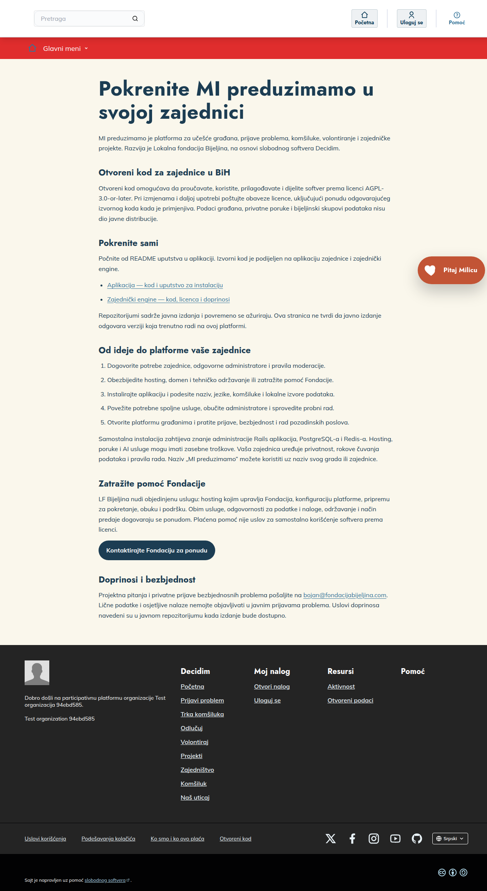

# MI preduzimamo — aplikacija zajednice

Otvorena platforma za lokalne zajednice u Bosni i Hercegovini, zasnovana na Decidim-u. Ovaj repozitorijum je referentna aplikacija; zajednički engine donosi funkcionalnosti platforme.

MI preduzimamo is a Decidim-based civic platform for communities in Bosnia and Herzegovina. This repository contains the community host application; the paired engine supplies reusable features.

Prikaz referentne aplikacije

Snimak stranice Otvoreni kod u izmišljenoj testnoj organizaciji. Ilustruje referentnu aplikaciju; ne prikazuje podatke stvarnih građana niti potvrđuje podešenost neke zajednice.

Decidim name and logo is a registered trademark of the Associació de Software Lliure Decidim. [Politika upotrebe žiga](https://decidim.org/trademark-policy/).

## Funkcionalnosti i priprema

Platforma obuhvata učešće građana, prijave problema, komšiluke, volontiranje, projekte, nenovčanu pomoć, donacije, bodove angažmana, lokalna obavještenja, poruke i asistentkinju Milicu. Kod svih funkcionalnosti je u obuhvatu izdanja; pojedine zahtijevaju lokalne podatke, administratorsko podešavanje ili spoljnu uslugu. Bijeljinski produkcioni podaci nisu dio distribucije.

Aplikacija koristi zajednički engine sa tačnim Git commitom u Gemfile.lock. Instalacija zahtijeva Ruby 3.4.12, Node prema .node-version, PostgreSQL, Redis i sistemske biblioteke navedene u konfiguraciji zavisnosti. Koristite odvojene razvojne, testne i produkcione resurse.

Početni koraci i sistemski administrator: [INSTALACIJA.md](docs/INSTALACIJA.md).

Detaljan pregled zahtjeva svake oblasti: [FUNKCIONALNOSTI.md](docs/FUNKCIONALNOSTI.md).

## Početno podešavanje

Installer je dostupan u v0.1.4. Nezavisna RC9 Windows/WSL2 proba potvrdila je čistu lokalnu instalaciju, direktnu RC7→RC9 nadogradnju i hladni restore u drugom praznom Docker okruženju. Završne ispravke demo identiteta i admin prevoda imaju ciljane regresije; cijela instalacija konačnog taga nije ponovljena, po odluci vlasnika. VPS/TLS, reboot VPS-a, off-site aktivacija i stvarni SMTP ostaju opcioni i neprovjereni. Detalji i ograničenja su u [rezultatima provjera](installation/REZULTATI_PROVJERA.md).

Za lokalnu izmišljenu zajednicu koristite [kratki Compose vodič](installation/LOKALNO.md): jedan installer priprema tajne, build, bazu i servise. Ruby 3.4.12, Node 22.23.4 i npm 10.9.9 dolaze kroz image; na domaćinu su potrebni Linux x86_64 (ili WSL2), Git, Python i Docker/Compose 2.30+.

Za javnu zajednicu postoji zaseban [VPS profil](installation/PRODUKCIJA.md). Prije otvaranja registracije pripremite svoje pravne tekstove, domen, podatke i odgovorne administratore. Backup/restore i nadogradnja kandidata još se dovršavaju; ograničenja i stvarni rezultati navedeni su u vodiču.

[Glavni instalacioni indeks](docs/INSTALACIJA.md) vodi do podešavanja oblasti. [Nezavisna WSL2 proba](installation/PROVJERA_WSL2.md) čuva razliku između kandidata, javnog izdanja i VPS dokaza.

## Spoljne usluge i privatnost

AI i komunikacione usluge nisu potrebne samo za čitanje izvornog koda. Njihovo uključivanje može slati sadržaj razgovora ili poruka i kontaktne podatke spoljnim pružaocima. Prije aktiviranja provjerite tokove podataka, ugovore, saglasnosti, rokove čuvanja i potrebne pristupne podatke. Lokalni adapteri zahtijevaju eksplicitno povezivanje sa izvorima vaše zajednice. Ne koristite kontakt Fondacije kao podrazumijevanu adresu za prijave građana druge zajednice.

## Održavanje i pomoć

Održavalac: Bojan Stojanović, za Lokalnu fondaciju Bijeljina. Projektni kontakt i privatne bezbjednosne prijave: bojan@fondacijabijeljina.com. Osjetljive nalaze nemojte objavljivati u javnim issues.

Fondacija nudi objedinjenu uslugu hostinga, konfiguracije, obuke i podrške. Za ponudu pišite na office@fondacijabijeljina.com. [Pregled pomoći i dogovora o usluzi](docs/POMOC_FONDACIJE.md) opisuje pripremu, odgovornosti i predaju. Plaćena pomoć nije uslov za korišćenje softvera prema licenci. Naziv MI preduzimamo možete koristiti uz naziv svog grada ili zajednice.

## Dokumentacija

[Puni indeks vodiča](docs/README.md) povezuje javna instalaciona, razvojna i operaterska uputstva.

## Licenca

AGPL-3.0-or-later; puni tekst je u LICENSE-AGPLv3.txt. Sačuvajte obavezne licence i tuđe autorske napomene. Identitet održavaoca ne znači da Fondacija vodi svaku instalaciju.

[Rezultati dosadašnjih proba i otvorene provjere](installation/REZULTATI_PROVJERA.md) sažimaju istorijski izvještaj bez privatnih priloga.
